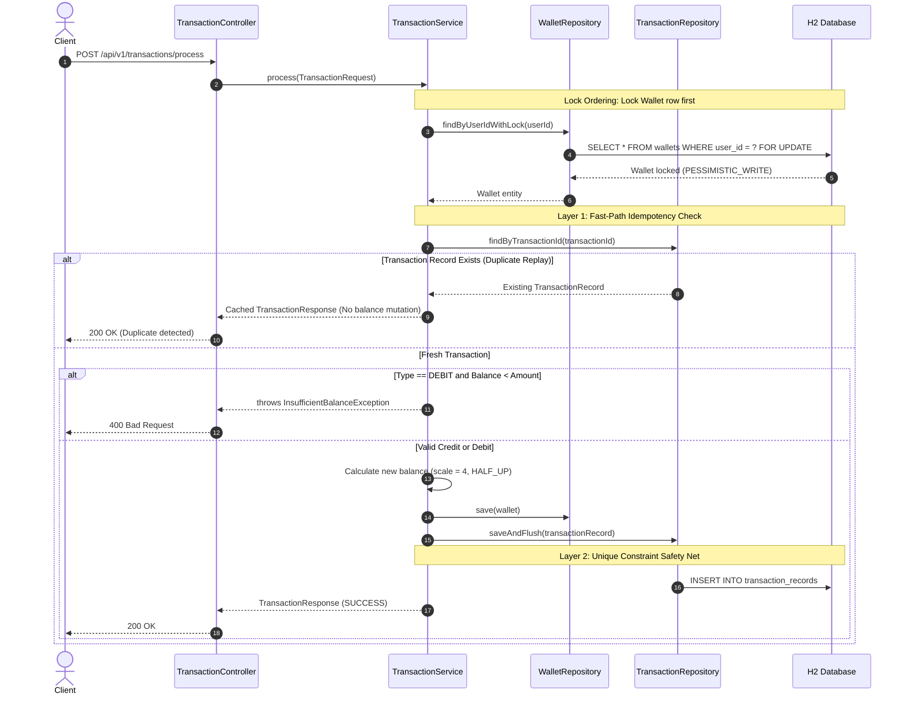

# PayGuard – Payment Event Processor

[](https://www.oracle.com/java/)
[](https://spring.io/projects/spring-boot)
[](https://spring.io/projects/spring-data-jpa)
[](https://www.h2database.com/)
[](https://junit.org/junit5/)

**PayGuard** is a robust, production-ready payment event processor engineered in **Java 17** and **Spring Boot 3.3.4**. It provides absolute transactional integrity, two-tier idempotency guarantees, and concurrency safety for financial wallets and payment events without relying on heavy external brokers or distributed lock orchestrators.

---

## 📑 Table of Contents
- [Key Features](#-key-features)
- [Architecture & Design Principles](#-architecture--design-principles)
- [Architecture & Flow Diagrams](#-architecture--flow-diagrams)
- [Database Schema](#-database-schema)
- [API Reference](#-api-reference)
- [Concurrency & Race Condition Handling](#-concurrency--race-condition-handling)
- [Two-Tier Idempotency Engine](#-two-tier-idempotency-engine)
- [Validation & Error Handling](#-validation--error-handling)
- [Running Locally](#-running-locally)
- [Automated Test Suite](#-automated-test-suite)
- [Implementation Progress](#-implementation-progress)

---

## 🚀 Key Features

- **Strict Financial Precision**: Employs `BigDecimal` with scale = 4 and `RoundingMode.HALF_UP` across all entities, arithmetic calculations, and DTO boundaries. Never uses floating-point types (`double`/`float`).
- **Pessimistic Database Locking**: Prevents race conditions and negative balances under high concurrent load using `@Lock(LockModeType.PESSIMISTIC_WRITE)`.
- **Global Lock Ordering**: Enforces a strict lock hierarchy (`WALLETS` row lock before querying `TRANSACTION_RECORDS`) to eliminate inter-table deadlocks during concurrent bursts.
- **Two-Tier Idempotency**:
  1. *Layer 1 (Fast-Path)*: In-flight check querying existing `transactionId`.
  2. *Layer 2 (Database Constraint)*: `UNIQUE` constraint index on `transaction_records.transaction_id` with `saveAndFlush()` to catch check-then-act races at the database level.
- **Immutable Audit Trail**: Every transaction is permanently captured with `balanceBefore`, `balanceAfter`, `status`, `type`, and timestamp.
- **Comprehensive Bean Validation**: Validates inputs with `@NotBlank`, `@Positive`, `@PositiveOrZero`, `@Digits`, and returns structured field-level error responses.
- **Unified Global Exception Handling**: Standardized error responses across all HTTP status codes (400, 404, 405, 409, 500).

---

## 🛠️ Architecture & Design Principles

### Layered Architecture
```text
src/main/java/com/payguard/
├── controller/     # REST Controllers handling HTTP requests, response wrapping & status codes
├── service/        # Transaction boundaries (@Transactional), business logic & lock acquisition
├── repository/     # Spring Data JPA repositories with custom query methods & pessimistic locks
├── entity/         # Relational entities (Wallet, TransactionRecord) with DB schema constraints
├── dto/            # Data Transfer Objects with Bean Validation constraints (@Digits, @Positive)
├── exception/      # Domain exceptions and @RestControllerAdvice GlobalExceptionHandler
├── config/         # Spring Boot & JSON configuration
└── PayGuardApplication.java
```

### Core Design Rules
1. **Never use `double` or `float` for money**: Floating-point representations introduce precision drift. All money values use `BigDecimal(scale = 4, RoundingMode.HALF_UP)`.
2. **Pessimistic Locking over Optimistic Locking**: Under high contention on a single wallet, optimistic locking (`@Version`) causes high transaction aborts and retry storms. Pessimistic row locking queues threads at the database row level, maximizing throughput without lost updates.
3. **Flushed Persistence**: `saveAndFlush()` is used when persisting transaction records to guarantee immediate execution of `INSERT` statements within the transaction boundary, reliably triggering unique constraint violations for concurrent duplicate detection.

---

## 📊 Architecture & Flow Diagrams

### Transaction Processing & Concurrency Flow



---

## 🗄️ Database Schema

### Table: `WALLETS`
| Column Name | Data Type | Constraints | Description |
|:---|:---|:---|:---|
| `id` | `BIGINT` | `PRIMARY KEY`, `AUTO_INCREMENT` | Internal synthetic identifier |
| `wallet_id` | `VARCHAR(255)` | `NOT NULL`, `UNIQUE` | Business identifier (e.g. `WLT-A1B2C3D4`) |
| `user_id` | `VARCHAR(255)` | `NOT NULL`, `UNIQUE` | Unique user reference |
| `balance` | `DECIMAL(19,4)` | `NOT NULL`, `DEFAULT 0.0000` | Account balance with 4 decimal places |
| `created_at` | `TIMESTAMP` | `NOT NULL` | Wallet creation timestamp |
| `updated_at` | `TIMESTAMP` | `NOT NULL` | Last balance modification timestamp |

### Table: `TRANSACTION_RECORDS`
| Column Name | Data Type | Constraints | Description |
|:---|:---|:---|:---|
| `id` | `BIGINT` | `PRIMARY KEY`, `AUTO_INCREMENT` | Internal synthetic identifier |
| `transaction_id`| `VARCHAR(255)` | `NOT NULL`, `UNIQUE` | External idempotency key |
| `wallet_id` | `VARCHAR(255)` | `NOT NULL` | Associated wallet identifier |
| `user_id` | `VARCHAR(255)` | `NOT NULL`, `INDEX` | User reference for history lookup |
| `amount` | `DECIMAL(19,4)` | `NOT NULL` | Transaction amount |
| `type` | `VARCHAR(20)` | `NOT NULL` | `CREDIT` or `DEBIT` |
| `status` | `VARCHAR(20)` | `NOT NULL` | `SUCCESS` or `FAILED` |
| `balance_before`| `DECIMAL(19,4)` | `NOT NULL` | Balance before execution |
| `balance_after` | `DECIMAL(19,4)` | `NOT NULL` | Balance after execution |
| `failure_reason`| `VARCHAR(500)` | `NULLABLE` | Description of failure (if status is FAILED) |
| `created_at` | `TIMESTAMP` | `NOT NULL`, `INDEX` | Audit timestamp |

---

## 📡 API Reference

Base URL: `http://localhost:8080`

### 1. Create Wallet
Creates a new wallet for a user with an optional initial balance.

- **URL**: `POST /api/v1/wallets`
- **Request Body**:
```json
{
  "userId": "USER_KRITIKA_01",
  "initialBalance": 1000.0000
}
```
- **Response (201 Created)**:
```json
{
  "walletId": "WLT-10FE78CF9AC4",
  "userId": "USER_KRITIKA_01",
  "balance": 1000.0000,
  "createdAt": "2026-11-07T17:30:00"
}
```
- **cURL Sample**:
```bash
curl -X POST http://localhost:8080/api/v1/wallets \
  -H "Content-Type: application/json" \
  -d '{"userId":"USER_KRITIKA_01","initialBalance":1000.0000}'
```

---

### 2. Get Wallet Balance
Fetches the current real-time balance for a given `userId`.

- **URL**: `GET /api/v1/wallets/{userId}/balance`
- **Response (200 OK)**:
```json
{
  "walletId": "WLT-10FE78CF9AC4",
  "userId": "USER_KRITIKA_01",
  "balance": 1000.0000
}
```
- **cURL Sample**:
```bash
curl -X GET http://localhost:8080/api/v1/wallets/USER_KRITIKA_01/balance
```

---

### 3. Get Wallet Details
Fetches complete wallet information by `userId` or `walletId`.

- **URL**: `GET /api/v1/wallets/{userId}` or `GET /api/v1/wallets/id/{walletId}`
- **Response (200 OK)**:
```json
{
  "walletId": "WLT-10FE78CF9AC4",
  "userId": "USER_KRITIKA_01",
  "balance": 1000.0000,
  "createdAt": "2026-11-07T17:30:00"
}
```

---

### 4. Process Payment Event (Credit / Debit)
Processes an idempotent transaction event.

- **URL**: `POST /api/v1/transactions/process`
- **Request Body (CREDIT)**:
```json
{
  "transactionId": "TXN_CREDIT_9901",
  "userId": "USER_KRITIKA_01",
  "amount": 500.2500,
  "type": "CREDIT"
}
```
- **Response (200 OK)**:
```json
{
  "transactionId": "TXN_CREDIT_9901",
  "status": "SUCCESS",
  "balanceAfter": 1500.2500,
  "message": "Transaction processed successfully."
}
```

- **Request Body (DEBIT)**:
```json
{
  "transactionId": "TXN_DEBIT_9902",
  "userId": "USER_KRITIKA_01",
  "amount": 300.1000,
  "type": "DEBIT"
}
```
- **Response (200 OK)**:
```json
{
  "transactionId": "TXN_DEBIT_9902",
  "status": "SUCCESS",
  "balanceAfter": 1200.1500,
  "message": "Transaction processed successfully."
}
```

- **Duplicate Request (Idempotency Replay)**:
Sending `TXN_DEBIT_9902` a second time:
```json
{
  "transactionId": "TXN_DEBIT_9902",
  "status": "SUCCESS",
  "balanceAfter": 1200.1500,
  "message": "Duplicate transaction detected. Returning original transaction result."
}
```

- **cURL Sample**:
```bash
curl -X POST http://localhost:8080/api/v1/transactions/process \
  -H "Content-Type: application/json" \
  -d '{"transactionId":"TXN_CREDIT_9901","userId":"USER_KRITIKA_01","amount":500.2500,"type":"CREDIT"}'
```

---

### 5. Fetch User Transaction History
Retrieves all historical transactions for a user ordered descending by creation time.

- **URL**: `GET /api/v1/transactions/user/{userId}`
- **Response (200 OK)**:
```json
[
  {
    "id": 2,
    "transactionId": "TXN_DEBIT_9902",
    "walletId": "WLT-10FE78CF9AC4",
    "userId": "USER_KRITIKA_01",
    "amount": 300.1000,
    "type": "DEBIT",
    "status": "SUCCESS",
    "balanceBefore": 1500.2500,
    "balanceAfter": 1200.1500,
    "failureReason": null,
    "createdAt": "2026-11-07T17:35:10"
  },
  {
    "id": 1,
    "transactionId": "TXN_CREDIT_9901",
    "walletId": "WLT-10FE78CF9AC4",
    "userId": "USER_KRITIKA_01",
    "amount": 500.2500,
    "type": "CREDIT",
    "status": "SUCCESS",
    "balanceBefore": 1000.0000,
    "balanceAfter": 1500.2500,
    "failureReason": null,
    "createdAt": "2026-11-07T17:32:00"
  }
]
```

---

## 🔒 Concurrency & Race Condition Handling

### The Problem
When multiple threads attempt to debit the same wallet concurrently (e.g. 10 simultaneous debit requests of ₹100 against a ₹500 balance):
1. **Lost Updates**: Thread A and Thread B read balance as ₹500 simultaneously. Both write ₹400, losing one debit.
2. **Negative Balances**: If all 10 threads read ₹500 before any commits, all 10 succeed, reducing the balance to -₹500.
3. **Deadlocks**: If Thread 1 holds a lock on `TRANSACTION_RECORDS` and waits for `WALLETS`, while Thread 2 holds a lock on `WALLETS` and waits for `TRANSACTION_RECORDS`.

### The PayGuard Solution
1. **Pessimistic Row Lock (`SELECT FOR UPDATE`)**:
   `WalletRepository.findByUserIdWithLock()` applies `@Lock(LockModeType.PESSIMISTIC_WRITE)`. Only one thread can hold the wallet row lock at any time. Subsequent concurrent requests are serialized at the database row level.
2. **Strict Global Lock Ordering**:
   `TransactionService.process()` acquires the lock on the `WALLETS` table **first** before executing any query or mutation on `TRANSACTION_RECORDS`. This uniform locking sequence eliminates circular wait conditions and completely avoids deadlocks.
3. **Automated Concurrency Verification**:
   Verified via `ConcurrencyIntegrationTest` and `PaymentEventProcessorIntegrationTest` using `ExecutorService` and `CountDownLatch` (10 concurrent threads against ₹500 balance resulted in exactly 5 successes, 5 failures, and a final balance of exactly ₹0.0000).

---

## 🔁 Two-Tier Idempotency Engine

Payment events may be retried across networks due to timeouts or duplicate webhooks. PayGuard protects financial integrity using two distinct defensive layers:

```text
Incoming Request -> [Layer 1: Fast-Path Query] ──(Found?)──> Return Cached Response
                            │ (Not Found)
                    [Pessimistic Wallet Lock]
                            │
                    [Calculate New Balance]
                            │
                    [Layer 2: saveAndFlush()] ──(Race Duplicate?)──> Handled via DB Unique Key
```

1. **Layer 1 (Fast-Path Read)**:
   Checks `transactionRepository.findByTransactionId(transactionId)` after acquiring the wallet lock. If found, it returns the previous `TransactionResponse` without altering the wallet balance.
2. **Layer 2 (Database Constraint Fallback)**:
   The column `transaction_records.transaction_id` has a database `UNIQUE` index constraint. If two identical requests pass the initial check concurrently, Hibernate executes `saveAndFlush()`. The database rejects the second `INSERT` with `Unique index violation`, preventing duplicate financial mutations.

---

## 🛡️ Validation & Error Handling

All incoming requests are validated at the controller boundary. When validation fails or domain exceptions are thrown, `GlobalExceptionHandler` returns consistent, structured JSON responses:

### Error Response Schema
```json
{
  "status": 400,
  "error": "Bad Request",
  "message": "amount: amount must be strictly greater than zero",
  "timestamp": "2026-11-07T17:40:00",
  "validationErrors": {
    "amount": "amount must be strictly greater than zero"
  }
}
```

### Handled Status Codes
| HTTP Status | Exception / Scenario | Response Error |
|:---|:---|:---|
| `400 BAD REQUEST` | Validation error, negative/zero amount, scale > 4 | `"Bad Request"` |
| `400 BAD REQUEST` | `InsufficientBalanceException` | `"Bad Request"` |
| `400 BAD REQUEST` | Malformed JSON or invalid enum value (`HttpMessageNotReadableException`) | `"Bad Request"` |
| `404 NOT FOUND` | `WalletNotFoundException`, non-existent route (`NoResourceFoundException`) | `"Not Found"` |
| `405 METHOD NOT ALLOWED`| Unsupported HTTP verb (`HttpRequestMethodNotSupportedException`) | `"Method Not Allowed"` |
| `409 CONFLICT` | Duplicate wallet for user (`WalletAlreadyExistsException`) | `"Conflict"` |
| `409 CONFLICT` | Database unique constraint violation (`DataIntegrityViolationException`) | `"Conflict"` |
| `500 INTERNAL SERVER ERROR` | Unhandled runtime errors | `"Internal Server Error"` |

---

## ⚙️ Running Locally

### Prerequisites
- **Java 17 LTS** or higher
- **Maven 3.9+** (or use included Maven Wrapper `mvnw.cmd` / `./mvnw`)

### 1. Build & Run
```bash
# Build the project
mvn clean install

# Run the Spring Boot application
mvn spring-boot:run
```
Or with Maven Wrapper on Windows:
```powershell
.\mvnw.cmd spring-boot:run
```

The application will start on port **`8080`**.

### 2. Access H2 In-Memory Database Web Console
- **URL**: `http://localhost:8080/h2-console`
- **JDBC URL**: `jdbc:h2:mem:payguarddb`
- **User Name**: `sa`
- **Password**: *(leave blank)*

---

## 🧪 Automated Test Suite

PayGuard includes **55 automated tests** covering unit, integration, concurrency, and validation flows:

```bash
mvn test
```

### Test Suite Breakdown
| Test Class | Category | Test Count | Description |
|:---|:---|:---:|:---|
| `PaymentEventProcessorIntegrationTest` | End-to-End Integration | 5 | Full customer lifecycle, mixed concurrent traffic, parallel duplicate replay safety, fault tolerance, arithmetic precision |
| `ConcurrencyIntegrationTest` | Concurrency & Race Conditions | 2 | 10-thread simultaneous debits preventing negative balance, concurrent duplicate transactions |
| `GlobalExceptionHandlerIntegrationTest` | Validation & Exceptions | 14 | Bean validation constraints, malformed JSON, invalid enums, 404, 405, 409 handlers |
| `TransactionControllerIntegrationTest` | REST API Integration | 8 | Transaction endpoints, idempotency replay, balance mutation |
| `WalletControllerIntegrationTest` | REST API Integration | 6 | Wallet creation, balance checks, duplicate wallet rejection |
| `TransactionServiceTest` | Service Layer Unit Tests | 7 | Credit, debit, overdraft checks, idempotency fast-path with Mockito |
| `WalletServiceTest` | Service Layer Unit Tests | 5 | Wallet creation, ID generation, user lookups |
| `RepositoryIntegrationTest` | JPA Repository Tests | 5 | `findByUserIdWithLock`, unique constraints, descending query order |
| `WalletEntityTest` | Entity Unit Tests | 2 | Balance update arithmetic, negative balance rejection |
| `PayGuardApplicationTests` | Smoke Tests | 1 | Spring ApplicationContext loading verification |
| **Total** | | **55 Passed** | **0 Failures, 0 Errors, 0 Skipped** |

---

## 🚦 Implementation Progress

- [x] **Section 1**: Project Initialization (Spring Boot setup, Maven, H2, package structure, git repository)
- [x] **Section 2**: Database and Entities (`Wallet` & `TransactionRecord`)
- [x] **Section 3**: Repository Layer (`WalletRepository` & `TransactionRepository`)
- [x] **Section 4**: Wallet Management APIs (Create, Get, Balance check)
- [x] **Section 5**: Transaction Processing (Credit, Debit, Balance update, Audit history)
- [x] **Section 6**: Idempotency (Duplicate detection, Replay handling)
- [x] **Section 7**: Concurrency Handling (Pessimistic locking, Concurrent debits)
- [x] **Section 8**: Validation and Exception Handling (Custom exceptions, Global handler)
- [x] **Section 9**: Integration & Concurrency Testing (JUnit 5, 10-thread debit test)
- [x] **Section 10**: Final Documentation & API Reference
